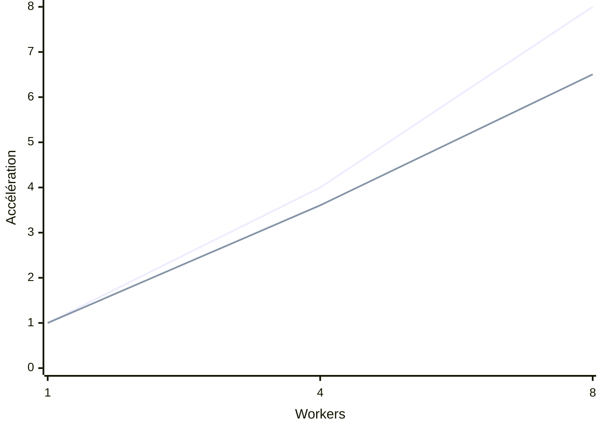

# Compte rendu séance 5 — team1

| Mesure | Valeur |
| --- | --- |
| Étape 0 : lignes dans `MANIFEST.json` (`train-sample`, `valid`, `test`) ; version et alias du modèle initial | 611 548 ; 311 624 ; 301 545 ; version 1, alias `champion` et `default` |
| Étape 1 : `run_id`, commit, image, graine, AP de validation | `20261118T175553Zeda7a3` ; `8c2691192d9cb5604b54bb8e9e605fac78a077c0` ; `europe-west1-docker.pkg.dev/advanced-cloud-ai/cloud-ai/fraud-train:td5` ; 42 ; 0,8512 |
| Étape 1 : durée de l'exécution ; `load` et `fit` de `metadata.json` | 72,36 s ; 16,52 s ; 26,22 s |
| Étape 3 : `run_id` du modèle 12 mois ; `fit` ; AP de validation | `20261118T192703Z4af774` ; 909,55 s ; 0,8854 |
| Étape 3 : AP test candidat et champion ; écart enregistré et IC à 95 % ; verdict | 0,8780 ; 0,8421 ; 0,0355 [0,0309 ; 0,0403] ; accepté |
| Étape 3 : version au registre ; `rang_lecture_test` | Version 2, alias `challenger` et `default` ; 1 |
| Étape 4 : débits DDP à 1 et 2 processus ; AP de validation | Mesures de la démonstration à récupérer |
| Lien du dépôt (`infra/job.tf`) | https://github.com/JuliusHayter/ai-cloud-infra-terraform-team-1 |

## Entraînement initial (étape 1)

Terraform définit le job Cloud Run `team1-train`, son compte de service,
ses droits et sa configuration : image, ressources, variables
d'environnement, accès au stockage et au réseau privé.

L'exécution est déclenchée séparément avec `gcloud run jobs execute`.
Les résultats sont conservés dans Cloud Storage sous
`runs/team1/models/<run_id>/` : `model.ubj`, `features.json` et `metadata.json`.

| Run | Chargement | Entraînement | Évaluation | AP validation | AUC validation |
| --- | --- | --- | --- | --- | --- |
| `20261118T175553Zeda7a3` | 16,52 s | 26,22 s | 2,82 s | 0,8512 | 0,9878 |
| `20261118T181127Z801440` | 19,42 s | 25,41 s | 2,95 s | 0,8512 | 0,9878 |

La première exécution complète dure 72,36 s, de
17:54:46.935250 à 17:55:59.299263 UTC le 18 novembre 2026.
Elle inclut des étapes supplémentaires aux trois durées applicatives.

Les deux entraînements utilisent les mêmes données, paramètres et graine.
Leurs métriques sont identiques à la précision enregistrée, avec des
temps d'exécution légèrement différents.

## Recherche (étape 2)

Chaque worker réalise ses propres essais Optuna. Les workers partagent
une étude dans PostgreSQL ; les threads accélèrent l'entraînement
XGBoost à l'intérieur de chaque worker.

| Étude | Workers | vCPU par tâche | Threads | Essais terminés | `wall_seconds` | Durée de l'exécution | `sum_fit_seconds` | Meilleure AP | Tâches réussies / lancées |
| --- | --- | --- | --- | --- | --- | --- | --- | --- | --- |
| w1-t1 | 1 | 1 | 1 | 40 | 1 565,29 s | 1 604,27 s | 1 404,08 s | 0,856104 | 1 / 1 |
| w4-t1 | 4 | 1 | 1 | 43 | 434,25 s | 469,54 s | 1 478,89 s | 0,855588 | 4 / 4 |
| w8-t1 | 8 | 1 | 1 | 47 | 240,64 s | 279,28 s | 1 451,23 s | 0,855164 | 8 / 8 |
| w4-t4 | 4 | 4 | 4 | 43 | 135,52 s | 176,98 s | 468,45 s | 0,855254 | 4 / 4 |

La durée d'exécution correspond à `completionTime - startTime`.
`wall_seconds` mesure la période de recherche, sans inclure tout le
démarrage et la fermeture des tâches.

Le seuil de 40 essais peut être dépassé : lorsque ce seuil est atteint,
d'autres workers ont encore des essais engagés. Nous obtenons ainsi
43 essais avec quatre workers et 47 avec huit.

### Courbe d'accélération

L'accélération est calculée sur `wall_seconds` :

`accélération = durée(w1-t1) / durée(configuration)`.

La première courbe représente l'idéal, la seconde les mesures.
Les positions horizontales représentent les trois configurations testées.

| Workers | Accélération mesurée | Accélération idéale |
| --- | --- | --- |
| 1 | 1,00 | 1 |
| 4 | 3,60 | 4 |
| 8 | 6,50 | 8 |

La configuration `w4-t4` n'est pas incluse dans cette courbe car les
ressources par tâche changent. Elle est 3,20 fois plus rapide que `w4-t1`,
en utilisant quatre fois plus de vCPU et de mémoire par tâche.

### Coût estimé de chaque recherche

Source : https://cloud.google.com/run/pricing  
Tarifs consultés le 18 novembre 2026 pour Cloud Run Jobs en `europe-west1` :

- CPU : 0,000018 USD par vCPU-seconde ;
- mémoire : 0,000002 USD par GiB-seconde.

Formule d'estimation :

`coût = workers × durée d'exécution ×
(vCPU par tâche × prix CPU + GiB par tâche × prix mémoire)`.

| Étude | vCPU par tâche | Mémoire par tâche | Durée utilisée | Coût estimé |
| --- | --- | --- | --- | --- |
| w1-t1 | 1 | 2 GiB | 1 604,27 s | 0,0353 USD |
| w4-t1 | 1 | 2 GiB | 469,54 s | 0,0413 USD |
| w8-t1 | 1 | 2 GiB | 279,28 s | 0,0492 USD |
| w4-t4 | 4 | 8 GiB | 176,98 s | 0,0623 USD |
| Total | | | | 0,1881 USD |

Chaque tâche est assimilée à la durée totale de son exécution.
Il s'agit d'une approximation : les durées réellement facturées
doivent être vérifiées tâche par tâche.

Les montants sont calculés aux prix catalogue, hors gratuité, remises,
taxes et coûts annexes : PostgreSQL, stockage, réseau et logs.
Les entraînements Vertex AI et le gate ne sont pas inclus.

## Entraînement final sur Vertex AI (étape 3, 12 mois)

Les trois entraînements utilisent une machine `n2-standard-8`,
les mêmes données de mai à juillet 2026 et les mêmes hyperparamètres.

| Threads | `rows.train` | `load` | `fit` | AP de validation |
| 1 | 9 228 428 | 238,78 s | 457,23 s | 0,8681 |
| 4 | 9 228 428 | 227,30 s | 165,20 s | 0,8681 |
| 8 | 9 228 428 | 226,90 s | 185,16 s | 0,8681 |

Quatre threads donnent ici le meilleur temps d'entraînement :
2,77 fois plus rapide qu'un thread. Huit threads sont plus lents que quatre.

Augmenter le nombre de threads ne garantit donc pas une accélération.
La coordination et les limites de bande passante mémoire peuvent intervenir ;
ces mesures seules ne permettent pas d'isoler la cause.

Le chargement des données varie peu avec le nombre de threads XGBoost.

## Modèle final et gate

Les hyperparamètres de `w1-t1` ont été retenus pour leur meilleure AP
de validation, avant toute lecture du test.

| Paramètre | Valeur |
| --- | --- |
| `n_estimators` | 365 |
| `max_depth` | 10 |
| `learning_rate` | 0,027646978540886005 |
| `subsample` | 0,7918951306600462 |
| `colsample_bytree` | 0,8770958600116194 |
| `min_child_weight` | 1,0585463413816736 |

Le modèle final est entraîné sur douze mois, d'août 2025 à juillet 2026,
soit 36 629 935 transactions, avec huit threads sur `n2-standard-8`.

| Mesure | Valeur |
| --- | --- |
| `run_id` | `20261118T192703Z4af774` |
| Chargement | 1 000,09 s |
| Entraînement | 909,55 s |
| Évaluation de validation | 1,48 s |
| AP validation | 0,8854 |
| AUC validation | 0,9912 |

Le gate compare une seule fois ce candidat au champion sur les
301 545 transactions du test de septembre 2026.

La règle impose que la borne basse de l'intervalle bootstrap à 95 %
de l'écart d'AP dépasse 0,003. Le calcul utilise 200 réplications
et la graine 20261110.

| Résultat du gate | Valeur |
| --- | --- |
| AP candidat | 0,8780 |
| AP champion | 0,8421 |
| Écart enregistré | 0,0355 |
| IC à 95 % de l'écart | [0,0309 ; 0,0403] |
| Verdict | Accepté |
| Rang de lecture du test | 1 |
| Version enregistrée | 2 |

La borne basse, 0,0309, dépasse la marge de 0,003.

Une incohérence est présente dans le journal : la différence des AP
affichées est 0,0359, alors que `delta_ap` indique 0,0355.
Nous conservons les valeurs enregistrées et signalons cet écart.
L'intervalle enregistré satisfait la règle d'acceptation.

Le fichier de décision principal indique `enregistrement_en_cours`.
Le fichier complémentaire `.registre.json` confirme ensuite
l'enregistrement en version 2, également vérifié dans Vertex AI.

| Version | Alias après le gate |
| --- | --- |
| 1 | `champion` |
| 2 | `challenger`, `default` |

L'enregistrement du candidat ne remplace donc pas l'alias `champion`.

## Six questions

### 1. Quelles données, quel code et quelle configuration ont produit notre modèle ?

Le candidat final utilise 36 629 935 transactions d'août 2025 à juillet
2026. La validation porte sur 311 624 transactions d'août 2026.
Le test de septembre est réservé au gate.

Le fichier `metadata.json` conserve les fichiers sources et leurs
empreintes SHA-256, les 20 variables explicatives, le commit du code,
l'image, les versions des bibliothèques, la graine et les paramètres.

Le commit est `8c2691192d9cb5604b54bb8e9e605fac78a077c0`,
l'image `fraud-train:td5` et la graine 42.
L'entraînement final utilise les paramètres de `w1-t1` et huit threads
sur `n2-standard-8`.

Le tag d'image étant modifiable, conserver son digest renforcerait
la reproductibilité.

### 2. Combien de temps prend la recherche avec un, quatre et huit workers ?

Sur `wall_seconds`, les durées sont respectivement :

- un worker : 1 565,29 s, soit environ 26 min 05 s ;
- quatre workers : 434,25 s, soit environ 7 min 14 s ;
- huit workers : 240,64 s, soit environ 4 min 01 s.

Les exécutions complètes durent respectivement
1 604,27 s, 469,54 s et 279,28 s.

### 3. Pourquoi le gain n'est-il pas proportionnel au nombre de workers ?

Les workers réalisent des essais différents, avec des durées variables.
Le chargement, les échanges avec PostgreSQL et la coordination ajoutent
du travail. Les derniers essais ne terminent pas simultanément.

Le nombre d'essais terminés varie également : 40, 43 et 47.
La quantité de travail n'est donc pas strictement identique.

Les accélérations observées sont 3,60 et 6,50 pour quatre et huit workers,
contre des accélérations idéales de 4 et 8.

### 4. Combien a coûté notre recherche, et avec quelles hypothèses ?

Les quatre recherches représentent environ 0,1881 USD de CPU et mémoire
Cloud Run aux prix catalogue.

L'estimation multiplie le nombre de tâches, la durée d'exécution et
le tarif des ressources allouées. Elle assimile chaque tâche à la durée
totale de l'exécution.

Elle exclut la gratuité, les remises et les services annexes.
Ce montant est une estimation du calcul Cloud Run, pas une facture observée.

### 5. Le modèle entre-t-il au registre, et sur quelle base ?

Oui, en version 2 avec l'alias `challenger`.

Le candidat a été sélectionné sans consulter le test. Le gate final
a ensuite comparé son AP à celle du champion sur le test de septembre.

La borne basse de l'intervalle à 95 % de l'écart d'AP vaut 0,0309,
au-dessus de la marge imposée de 0,003. Le candidat est donc accepté.

Le registre conserve la version 1 sous l'alias `champion`.
La version 2 porte les alias `challenger` et `default`.
Le journal indique une seule lecture du test.

### 6. Démonstration DDP : qu'apporte le second processus, et pourquoi ?

**Alexandro —** Les débits, AP et modifications de code de la démonstration
restent à récupérer auprès du professeur ou d'un collègue.

DDP répartit les données entre les processus, chacun conservant une copie
du modèle. Les gradients sont synchronisés afin que les copies soient
mises à jour de manière cohérente.

Un second processus peut augmenter le débit s'il dispose de ressources
de calcul supplémentaires. Le coût de synchronisation limite le gain :
doubler les processus ne garantit pas de doubler le débit.

DDP ne répartit pas la mémoire du modèle entre les processus :
chacun conserve les paramètres, les gradients et l'état de l'optimiseur.
FSDP ou ZeRO permettent de répartir ces éléments.

Les autres étudiants ajoutent leur réponse personnelle signée.